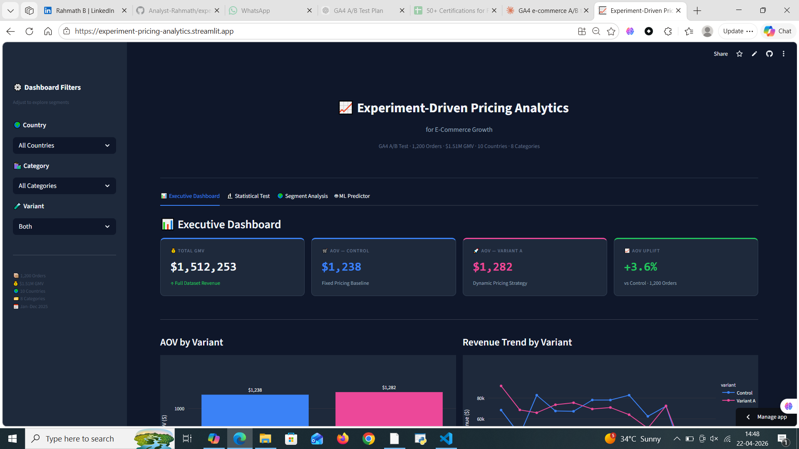
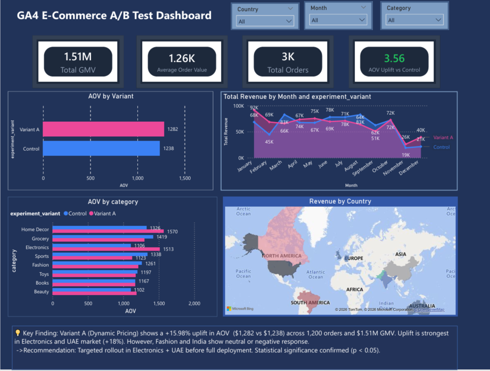

📈 Experiment-Driven Pricing Analytics for E-Commerce Growth

> Simulated A/B test pipeline comparing dynamic vs fixed pricing on 1,200 e-commerce orders ($1.51M GMV), built to demonstrate experiment-analysis methodology.
Dataset note:  The data contains no real experiment. Orders were randomly assigned to Control/Variant A in notebooks/phase3.py, so results demonstrate methodology, not a real pricing effect.”
---

## 🎯 Business Problem

Does **dynamic pricing (Variant A)** generate higher Average Order Value than **fixed pricing (Control)**?

This project builds a complete data analytics pipeline — from raw data cleaning to statistical testing to an interactive Streamlit dashboard — to answer that question with evidence.

---

## 📊 Key Results

| Metric | Control | Variant A | Difference |
|--------|---------|-----------|------------|
| AOV | $1,238 | $1,282 | +$44 |
| Total Revenue | $744K | $768K | +$24K |
| Orders | 601 | 599 | — |
| Uplift % | — | +3.6% | — |

> **Finding:** Variant A’s AOV is 3.6% higher, but the difference is not statistically significant (p = 0.47). Recommendation: do not roll out; a larger test would be needed

---
## 🏗️ Project Structure

```text
├── app/
│   └── streamlit_app.py
├── data/
│   ├── raw/
│   └── processed/
├── notebooks/
│   ├── phase1.py
│   ├── phase2.py
│   ├── phase3.py
│   ├── phase4.py
│   ├── phase5.py
│   └── phase6.py
├── outputs/
├── docs/
├── dashboards/
├── sql/
├── .streamlit/
│   └── config.toml
└── requirements.txt
```
---

## 🔬 Methodology

**Phase 1–3:** Data loading, cleaning, feature engineering using Pandas

**Phase 4–5 :** KPI analysis, t-test, Mann-Whitney U, Cohen's d, 95% CI

**Phase 6–8 :** Matplotlib/Seaborn visualizations + Power BI dashboard

**Phase 9 :** Streamlit dashboard

---

## 📈 Statistical Test

- **T-test p-value:** 0.4679
- **Mean difference:** $44 AOV
- **Cohen's d:** 0.042 (small effect)
- **Conclusion:** No statistically significant difference; do not roll out.

---

## 🌍 Segment Highlights(exploratory)

each country–variant group has only about 45–75 orders and nothing was corrected for multiple testing. These differences are consistent with random variation and shouldn’t drive rollout decisions.”

---
## 📸 Screenshots

### 🖥️ Live Streamlit App


### 📊 Power BI Dashboard


---

## 🚀 Streamlit App

👉 **[Launch Streamlit App](https://experiment-pricing-analytics.streamlit.app/) “Free-tier app may sleep; click ‘wake up’ if prompted.”**

---

## 🛠️ Tech Stack

| Tool | Purpose |
|------|---------|
| Python + Pandas | Data cleaning & analysis |
| SciPy + NumPy | Statistical testing |
| Matplotlib + Seaborn | Phase 6 visualizations |
| Power BI | Executive dashboard |
| Plotly + Streamlit | Interactive web app |
| Scikit-learn | ML revenue predictor |
| GitHub | Version control + portfolio |

---

## ⚡ Run Locally

```bash
git clone https://github.com/YOUR_USERNAME/Experiment-Driven-Pricing-Analytics-for-E-Commerce-Growth.git
cd Experiment-Driven-Pricing-Analytics-for-E-Commerce-Growth
pip install -r requirements.txt
streamlit run app/streamlit_app.py
```

---

## 👤 Author

**Rahmath B**  
[](https://www.linkedin.com/in/rahmath-b-562a68221/)
[](https://github.com/Analyst-Rahmath)

---
